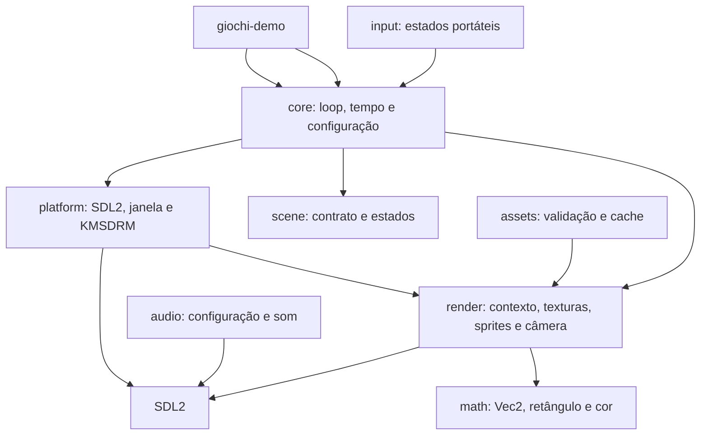

# Arquitetura

## Módulos



O objetivo é manter regras de jogo e tipos reutilizáveis separados do acesso ao sistema.
`platform` controla inicialização e janela SDL2; `render` mantém o contexto de desenho,
carregamento SDL_image, primitivas, sprites e conversões de câmera. `TextureLoader` é obtido junto ao contexto de desenho e empresta o criador de texturas guardado
pela janela; assim, o compilador impede que texturas ou o contexto sobrevivam ao canvas SDL2.

## Fluxo de inicialização

```text
main → init_sdl → Window::new → game_loop::run
                                 → coleta Quit/Escape
                                 → Game::update (passo fixo)
                                 → Game::render → apresentação do quadro
```

`core::game_loop` usa um timestep de 1/60 s, acumulador e limite de 250 ms para descartar atrasos
excessivos. `core::time::Time` mede delta, tempo decorrido e quadros. O loop consome eventos
traduzidos pela plataforma e encerra com Quit ou Escape, sem importar SDL2 diretamente. A camada
de jogo recebe `render::renderer::RenderContext`; falhas de desenho são reportadas como
`RenderError` e propagadas pelo loop.

## Regras de dependência

- `math` não depende de SDL2 nem das demais camadas.
- `render` depende do SDL2 apenas para a implementação privada do contexto e dos handles de
  textura; a API de jogo usa `math::Color`, `math::Rect` e `RenderError`, sem expor o canvas.
- `core` não importa `sdl2` diretamente; depende do contrato em `render`.
- `scene` depende do contrato de desenho de `render`, mas não do loop concreto.
- `math` não depende de SDL2 nem de outras camadas internas.
- `assets` mantém cache genérico; a integração com carregamento/cache de áudio será feita na fase
  de assets e áudio.

## Erros

Biblioteca e plataforma usam erros tipados com `thiserror`. Binários, exemplos e aplicações
consumidoras podem compor falhas com `anyhow`. A inicialização SDL2 inclui orientação para
diagnosticar permissões de `/dev/dri` e grupos de dispositivos.
