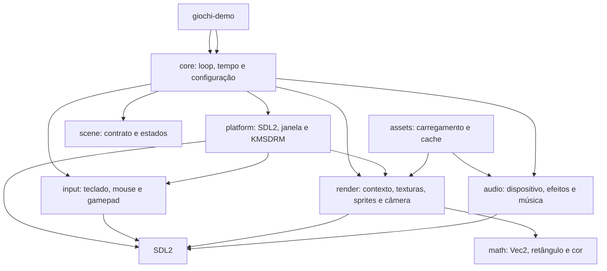

# Arquitetura

## Módulos



O objetivo é manter regras de jogo e tipos reutilizáveis separados do acesso ao sistema.
`platform` controla inicialização e janela SDL2; `render` mantém o contexto de desenho,
carregamento SDL_image, primitivas, sprites e conversões de câmera. `TextureLoader` é obtido junto ao contexto de desenho e empresta o criador de texturas guardado
pela janela; assim, o compilador impede que texturas ou o contexto sobrevivam ao canvas SDL2.
`platform::Sdl::poll_input` coleta os eventos uma vez, atualiza a entrada portátil e informa se o
loop deve encerrar; os jogos consultam apenas `input::Input`.

## Fluxo de inicialização

```text
main → init_sdl → Window::new → game_loop::run
                                 → Input::new (gamepad opcional)
                                 → poll_input (Quit/Escape + eventos)
                                 → Game::update(dt, &input) (passo fixo)
                                 → Game::render → apresentação do quadro
```

`core::game_loop` usa um timestep de 1/60 s, acumulador e limite de 250 ms para descartar atrasos
excessivos. `core::time::Time` mede delta, tempo decorrido e quadros. A plataforma entrega os
eventos já convertidos em estado de entrada e encerra com Quit ou Escape, sem que `core` importe
SDL2. A camada de jogo recebe `input::Input` e `render::renderer::RenderContext`; falhas de desenho
são reportadas como `RenderError` e propagadas pelo loop.

## Regras de dependência

- `math` não depende de SDL2 nem das demais camadas.
- `render` depende do SDL2 apenas para a implementação privada do contexto e dos handles de
  textura; a API de jogo usa `math::Color`, `math::Rect` e `RenderError`, sem expor o canvas.
- `core` não importa `sdl2` diretamente; depende de `input` e `render` como contratos.
- `input` é a única camada que decodifica eventos de teclado, mouse e controle; expõe apenas
  enums, `Vec2` e estados por quadro, sem vazar handles SDL2.
- `platform` alimenta `Input` porque é a dona do `EventPump`; assim `core` não conhece eventos SDL.
- `scene` depende do contrato de desenho de `render`, mas não do loop concreto.
- `math` não depende de SDL2 nem de outras camadas internas.
- `assets` é a única camada que lê arquivos do jogo e mantém `ResourceManager` com `Rc` para
  texturas, sons, músicas e fontes; `loader` traduz falhas de SDL_image/SDL_mixer/SDL_ttf em
  `AssetError`.
- `audio` encapsula `SDL_mixer`: `AudioSystem` é dono do dispositivo e dos canais, `Sound` é um
  efeito curto (arquivo ou amostras PCM) e `MusicTrack` é uma música transmitida com controle.
  `assets` usa `audio`, mas `audio` não conhece `assets`.

## Erros

Biblioteca e plataforma usam erros tipados com `thiserror`. Binários, exemplos e aplicações
consumidoras podem compor falhas com `anyhow`. A inicialização SDL2 inclui orientação para
diagnosticar permissões de `/dev/dri` e grupos de dispositivos.
