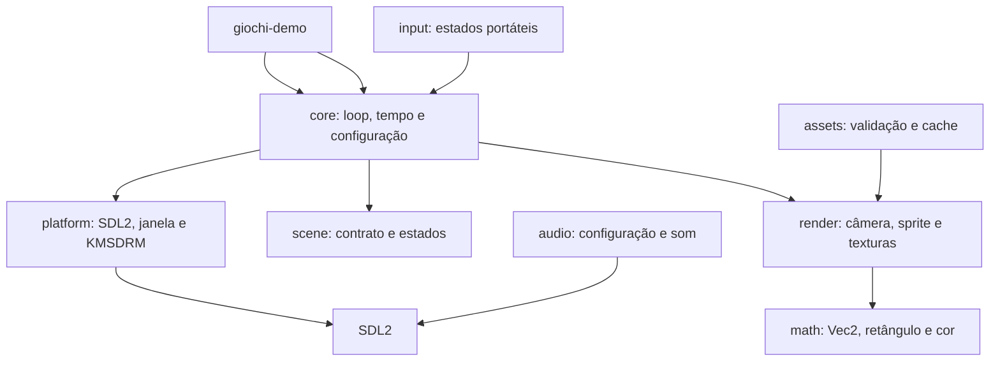

# Arquitetura

## Módulos



O objetivo é manter regras de jogo e tipos reutilizáveis separados do acesso ao sistema.
Atualmente, a janela e o contexto de desenho SDL2 estão em `platform`; os módulos de áudio,
carregamento de imagens e renderização de sprites ainda oferecem tipos-base, não operações SDL.

## Fluxo de inicialização

```text
main → init_sdl → Window::new → game_loop::run
                                 → coleta Quit/Escape
                                 → Game::update (passo fixo)
                                 → Game::render → apresentação do quadro
```

`core::game_loop` usa um timestep de 1/60 s, acumulador e limite de 250 ms para descartar atrasos
excessivos. `core::time::Time` mede delta, tempo decorrido e quadros. O loop consome eventos
traduzidos pela plataforma e encerra com Quit ou Escape, sem importar SDL2 diretamente.
O binário `giochi-demo` cria a janela e roda um jogo mínimo que limpa a tela.

## Regras de dependência

- `math` não depende de SDL2 nem das demais camadas.
- `render` contém tipos independentes do SDL2; `platform::window` adapta o canvas SDL2 para
  o contrato `RenderContext`.
- `core` não importa `sdl2` diretamente; usa o `RenderContext` exposto pela plataforma.
- `scene` depende do contrato de desenho da plataforma, mas não do loop concreto.
- `assets` e `audio` isolam cache e tipos de configuração; os carregadores SDL serão adicionados
  sem expor handles SDL em módulos centrais.

## Erros

Biblioteca e plataforma usam erros tipados com `thiserror`. Binários, exemplos e aplicações
consumidoras podem compor falhas com `anyhow`. A inicialização SDL2 inclui orientação para
diagnosticar permissões de `/dev/dri` e grupos de dispositivos.
