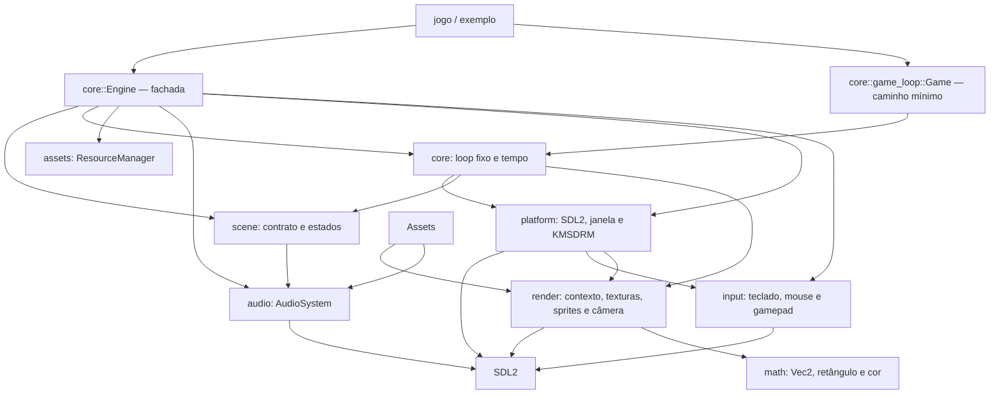

# Arquitetura

## Módulos



O objetivo é manter regras de jogo e tipos reutilizáveis separados do acesso ao sistema.
`platform` controla inicialização e janela SDL2; `render` mantém o contexto de desenho,
carregamento SDL_image, primitivas, sprites e conversões de câmera. `TextureLoader` é obtido junto ao contexto de desenho e empresta o criador de texturas guardado
pela janela; assim, o compilador impede que texturas ou o contexto sobrevivam ao canvas SDL2.
`platform::Sdl::poll_input` coleta os eventos uma vez, atualiza a entrada portátil e informa se o
loop deve encerrar; os jogos consultam apenas `input::Input`.

## Fluxo de inicialização

Dois caminhos coexistem: a fachada completa e o loop mínimo.

```text
# Caminho completo
main → init_sdl → Window::new → Engine::new(sdl, &mut window, config)
                                → Window::split (alvo de desenho + criador de texturas)
                                → Input::new + AudioSystem::init (opcional)
        Engine::run(scene) → SceneManager::push + apply_pending (on_enter)
                           → loop: poll_frame → handle_event
                                   → FixedStepper::advance → Scene::update (1/60 s)
                                   → Scene::render + ensure_cleared + present
                                   → apply_pending (push/pop/replace entre quadros)

# Caminho mínimo
main → init_sdl → Window::new → game_loop::run(&mut game, &mut window, &mut sdl)
```

`core::Engine` possui o `Sdl`, a entrada, o áudio, o cache e a pilha de cenas; a janela é
emprestada e dividida em `RenderTarget` (canvas mutável) e `&TextureCreator` (imutável), ambos
campos distintos de `Window`. Assim o cache de texturas pode viver ao lado do alvo de desenho sem
auto-referência e sem `unsafe`.

`core::game_loop` usa um timestep de 1/60 s, acumulador e limite de 250 ms para descartar atrasos
excessivos. `core::time::Time` mede delta, tempo decorrido e quadros. A plataforma entrega os
eventos já convertidos em estado de entrada e encerra com Quit ou Escape, sem que `core` importe
SDL2. A camada de jogo recebe `input::Input` e `render::renderer::RenderContext`; falhas de desenho
são reportadas como `RenderError` e propagadas pelo loop.

## Regras de dependência

- `math` não depende de SDL2 nem das demais camadas.
- `render` depende do SDL2 apenas para a implementação privada do contexto e dos handles de
  textura; a API de jogo usa `math::Color`, `math::Rect` e `RenderError`, sem expor o canvas.
- `core` não importa `sdl2` diretamente; depende de `input` e `render` como contratos.
  A exceção é o campo `&TextureCreator` guardado por `Engine`, que existe apenas para empréstimo.
- `scene` depende de `assets`, `audio`, `input` e `render`; não conhece `platform` nem o loop.
- `Engine` é a única peça que conhece todos os módulos ao mesmo tempo; `scene` nunca importa
  `core`.
- `input` é a única camada que decodifica eventos de teclado, mouse e controle; expõe apenas
  enums, `Vec2` e estados por quadro, sem vazar handles SDL2.
- `platform` alimenta `Input` porque é a dona do `EventPump`; assim `core` não conhece eventos SDL.
- `math` não depende de SDL2 nem de outras camadas internas.
- `assets` é a única camada que lê arquivos do jogo e mantém `ResourceManager` (`'w`, vinculado à
  janela) e `FontCache` (`'t`, vinculado ao `FontLoader`); `loader` traduz falhas de
  SDL_image/SDL_mixer/SDL_ttf em `AssetError`.
- `audio` encapsula `SDL_mixer`: `AudioSystem` é dono do dispositivo e dos canais, `Sound` é um
  efeito curto (arquivo ou amostras PCM) e `MusicTrack` é uma música transmitida com controle.
  `assets` usa `audio`, mas `audio` não conhece `assets`.

## Transições de cena

`SceneManager` aplica `push`/`pop`/`replace` no intervalo entre quadros, nunca durante `update` ou
`render`. Consequências documentadas e testadas:

- A cena recém-empilhada recebe `on_enter` no fim do quadro em que a transição foi pedida e passa a
  desenhar no quadro seguinte.
- `push` sobre uma cena existente chama `on_exit` da anterior; `pop` chama `on_exit` da removida e
  `on_enter` de novo na cena que volta a ser o topo (útil para recarregar estado).
- Eventos SDL são entregues do topo para a base e param no primeiro `handle_event` que retornar
  `true`.

## Erros

Biblioteca e plataforma usam erros tipados com `thiserror`. Binários, exemplos e aplicações
consumidoras podem compor falhas com `anyhow`. A inicialização SDL2 inclui orientação para
diagnosticar permissões de `/dev/dri` e grupos de dispositivos.
